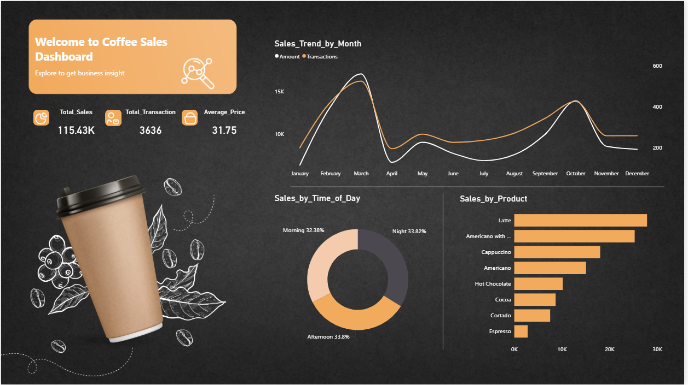

# Coffee Sales Analysis | Power BI

An interactive Power BI report for exploring coffee sales performance, transaction patterns and product trends.

## Business questions

- How do sales change across months?
- How many transactions are recorded?
- What is the average transaction value?
- Which coffee products contribute most to sales?
- How are sales distributed across time-of-day periods?

## Dashboard preview

## Report contents

- Monthly sales trend.
- Total sales, transaction count and average-price KPIs.
- Sales by time of day.
- Product-level sales comparison.

## Repository files

- `Coffee_sales_analysis.pbix` — Power BI report.
- `Coffe_sales.xlsx` — source workbook (filename retained as uploaded).
- `Coffee_sales_dashboard.png` — dashboard preview.

## Tools

- Microsoft Power BI Desktop
- Excel for source-data preparation

## Open the report

1. Download the PBIX and source workbook.
2. Open the PBIX file in Power BI Desktop.
3. If prompted, reconnect the source to the downloaded workbook.
4. Refresh the model and explore the report filters.

## Findings

The current report highlights monthly variation, product-level performance and differences across time-of-day categories. Exact numerical claims should be checked against the refreshed report and source workbook before being quoted.

## Data and reproducibility

Add the original dataset source and its license/usage terms here before redistributing the workbook. Do not include confidential or personally identifiable customer information.

## Author

**Ashiba B**

[LinkedIn](https://www.linkedin.com/in/ashiba-data-analyst) · [GitHub](https://github.com/ash-sheik)
